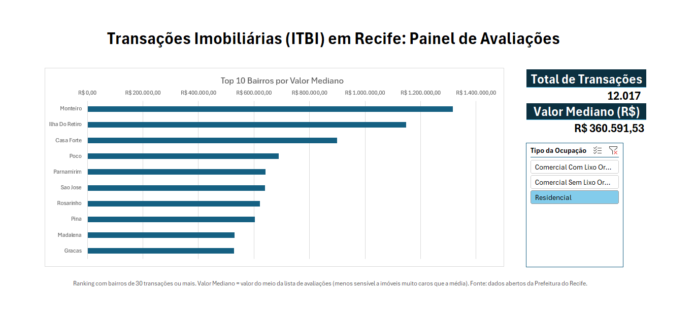

# Dashboard ITBI Recife 2026

Dashboard interativo em Excel sobre transações imobiliárias com recolhimento de ITBI (Imposto sobre Transmissão de Bens Imóveis) no Recife, em 2026.

*Print com o filtro Residencial (12.017 transações). O arquivo completo tem 13.852 transações.*

## Fonte dos dados
Portal de Dados Abertos da Prefeitura do Recife (Secretaria de Finanças): [ITBI 2026](https://dados.recife.pe.gov.br/dataset/imposto-sobre-transmissao-de-bens-imoveis-itbi/resource/fc95e204-a121-4b7a-94b2-e4420539c0d1). Dados atualizados em 2 de outubro de 2026.

## O que foi feito
- **Limpeza (Power Query):** seleção de colunas, tipos de dados, padronização de textos e tratamento de valores inconsistentes
- **Modelagem (Power Pivot):** tabela fato de transações e tabelas de apoio (bairro, tipo do imóvel, ocupação e conservação) ligadas por relacionamentos
- **Medidas (DAX):** total de transações, valor médio, valor mediano e mediana apenas para bairros com 30 transações ou mais
- **Dashboard:** gráfico dinâmico, cartões de resumo e segmentação por tipo de ocupação

## Alguns achados
- Nas transações residenciais, o valor mediano de avaliação é cerca de R$ 360 mil, enquanto a média é cerca de R$ 546 mil. Poucas transações de valor muito alto puxam a média para cima, e por isso o painel usa a mediana
- Entre os bairros com 30 transações ou mais, os maiores valores medianos estão em Monteiro, Ilha do Retiro, Casa Forte, Poço e Parnamirim
- Transações comerciais de grande porte distorcem os números gerais, então o painel separa por tipo de ocupação

## Limitações
- Cada linha é uma **transação**, não um imóvel único
- O campo usado é o "valor de avaliação" da base. O dicionário de dados não detalha se ele equivale ao preço de venda
- O ranking considera só bairros com 30 transações ou mais,
